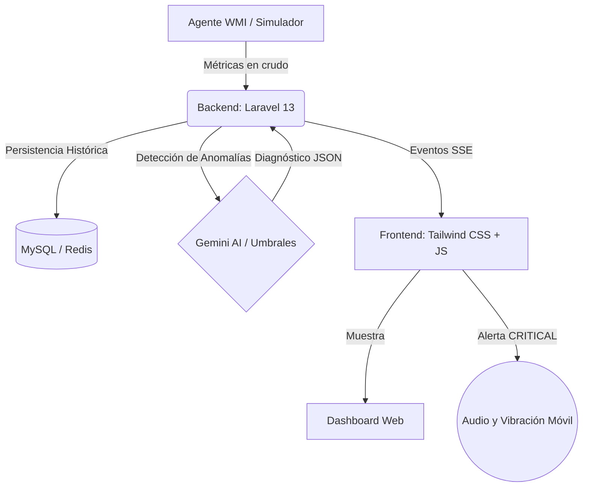

# 🌐 FiberPulse AI
**Plataforma de Telemetría e IAoT en Tiempo Real**

<div align="center">


</div>

> **Proyecto de Transferencia Tecnológica**  
> 🏢 **Centro Nacional Colombo Alemán — SENA Regional Atlántico**  
> 💻 **Programa:** Análisis y Desarrollo de Software (ADSO)  
> 🇨🇳 **Misión Internacional:** [Chongqing Polytechnic University of Electronic Technology (CQUET)](https://www.cqepc.edu.cn) — Chongqing, China.

---

## 📖 Acerca del Proyecto

**FiberPulse AI** es un dashboard de telemetría diseñado para entornos educativos y demostraciones técnicas en redes de banda ancha e IoT industrial. 

El sistema actúa como un puente entre la infraestructura de red física y el análisis de software. Captura métricas de hardware en vivo, las transmite al frontend instantáneamente mediante **Server-Sent Events (SSE)** y utiliza la **API de Google Gemini** para diagnosticar anomalías (como picos de temperatura o caídas de red) en tiempo real, emitiendo alertas visuales, sonoras y de vibración.

---

## ✨ Características Destacadas

*   **📊 Telemetría en Vivo (SSE):** Monitoreo cada 5 segundos de CPU, RAM, Temperatura, Latencia, Throughput y Señal Óptica sin necesidad de recargar la página ni usar bases de datos lentas para la vista en vivo.
*   **🤖 Diagnóstico Predictivo Híbrido:** Integración con Gemini 3.5 Flash Lite para análisis inteligente, con un sistema de respaldo automático basado en umbrales locales por si falla la API.
*   **🚨 Sistema de Alertas Multisensorial:** 
    *   Visual (Gráficos Chart.js animados y LEDs de estado).
    *   Auditiva (Tono de alerta sintetizado vía Web Audio API).
    *   Háptica (Vibración nativa en dispositivos móviles Android al detectar fallas críticas).
*   **🕹️ Panel de Simulación:** Área protegida por PIN para inyectar anomalías controladas (sobrecarga de CPU, caída óptica, fuga de RAM, etc.) ideal para demostraciones en vivo.
*   **📱 Conexión Rápida por QR:** Acceso instantáneo al dashboard desde cualquier dispositivo conectado a la misma red local (LAN).

---

## 🏗️ Arquitectura de Datos

El sistema sigue un flujo unidireccional de alta velocidad para garantizar el rendimiento en tiempo real:



---

## ⚙️ Tecnologías Utilizadas

*   **Backend:** Laravel 13, PHP 8.4, MySQL 8.0, Redis 7.x.
*   **Frontend:** Tailwind CSS 4.0, JavaScript ES2024, Chart.js, qrcode.js, Vite.
*   **Infraestructura:** Docker Compose, Agente nativo de PowerShell (WMI).
*   **APIs Nativas:** Server-Sent Events, Web Audio API, Vibration API (`navigator.vibrate`).

---

## 🚀 Guía de Despliegue Rápido (Docker)

La forma más rápida y recomendada de probar FiberPulse AI es utilizando **Docker Desktop**.

**1. Clonar el repositorio**
```bash
git clone https://github.com/tu-usuario/fiberpulse-ai.git
cd fiberpulse-ai
```

**2. Configurar las variables de entorno**
```bash
cp .env.example .env
```
*(Abre el archivo `.env` y añade tu `GEMINI_API_KEY`. Si planeas usar el código QR en una red local, ajusta la variable `APP_URL=http://TU_IP_LOCAL:8000` con la IP de tu computadora).*

**3. Levantar los servicios**
```bash
docker compose up --build -d
```
*(Este comando iniciará Laravel, MySQL, Redis, el recolector de datos y el procesador de colas. Tarda unos 3-5 minutos la primera vez).*

**4. ¡Listo!** Visita `http://localhost:8000` en tu navegador.

---

## 💻 Instalación Local (Sin Docker)

Si prefieres ejecutar el proyecto utilizando tu propio entorno (como Laragon o XAMPP):

```bash
# 1. Instalar dependencias
composer install
npm install

# 2. Configurar entorno y base de datos
cp .env.example .env
php artisan key:generate
php artisan migrate

# 3. Compilar assets del frontend
npm run dev

# 4. Iniciar servicios (en terminales separadas)
php artisan serve --host=0.0.0.0 --port=8000
php artisan queue:work
php artisan telemetry:collect
```

---

## 🎯 Impacto y Demostraciones (SENA)

Este repositorio está diseñado para cumplir con los objetivos de transferencia tecnológica:

1.  **Conferencia Pública (50 asistentes):** Utilizando el modo de "Inyección de Anomalías" y el código QR, se puede conectar a todo el auditorio simultáneamente. Al disparar un evento crítico de red, los 50 celulares de los asistentes sonarán y vibrarán al mismo tiempo, ilustrando el poder del IoT en tiempo real.
2.  **Laboratorio Práctico (30 aprendices):** El código está estructurado para que los estudiantes de ADSO puedan clonarlo, modificar los umbrales de alerta físicos (ej. `app/Models/TelemetryLog.php`) e interactuar con la ingeniería de prompts de la IA (`config/gemini.php`).

---

## 📄 Licencia y Créditos

Este proyecto está bajo la Licencia **MIT**. Eres libre de usarlo, modificarlo y distribuirlo para fines educativos.

*   **Autor:** Humberto Hernando Díaz Rada 
*   **Centro de Formación:** Centro Nacional Colombo Alemán - SENA Regional Atlántico
*   **Contacto:** [GitHub - HumbertoDR](https://github.com/HumbertoDR)